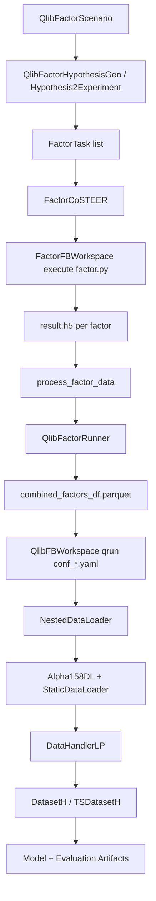
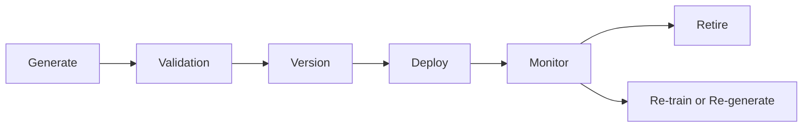

# RD-Agent Source Code Architecture (Qlib Factor Chain)

Date: 2026-07-01  
Scope: Source-code architecture research only (no implementation)

## 1. Why This Document Exists

Phase-1 command-level research is complete.  
This document moves to phase-2 source-level architecture, focusing on the chain that will matter for production integration:

Platform-level follow-up is documented in:
`rdagent/docs/research/16_Financial_Feature_Store_Architecture.md`

CLI -> Scenario -> Runner -> Evaluator -> Qlib DataLoader/Handler -> Artifacts

Primary focus classes:

- QlibFactorScenario
- FactorTask
- QlibFactorRunner
- FactorCoSTEER
- StaticDataLoader
- DataHandlerLP

---

## 2. Core Finding: The Right Input Question

The most important architecture question is **not** whether RD-Agent can read your raw statement CSVs directly.

The right question is:

What data contract does the factor runner/evaluator chain require at runtime?

### 2.1 Runtime Contract Observed in Source

`QlibFactorRunner` merges generated factor outputs into a DataFrame, saves `combined_factors_df.parquet`, and runs Qlib configs that load it through `StaticDataLoader`.

That means the operational contract is effectively a daily panel feature table consumable by Qlib, not raw accounting files.

Practical consequence:

```text
Yahoo Gold raw financial CSV
  -> PIT ETL + daily alignment
  -> daily factor table
  -> StaticDataLoader / DataHandlerLP
  -> model training + backtest
```

This is the natural integration axis for your NA platform.

---

## 3. End-to-End Class/Data Flow



---

## 4. QlibFactorScenario: What It Really Does

## 4.1 Scenario Input Source

`QlibFactorScenario` does not directly read your `income_statement/`, `balance_sheet/`, `cash_flow/` folders.

It builds scenario text from:

1. Runtime environment introspection (`get_runtime_environment`)  
2. Data folder introduction (`get_data_folder_intro`)

`get_data_folder_intro` reads from `FACTOR_COSTEER_SETTINGS.data_folder_debug`; if missing, it auto-generates debug HDF data from Qlib templates.

### Answer to your question: "Scenario 从哪里拿 feature？"

- From configured factor coder data folders (debug/full), represented as HDF docs in prompt context.
- Not from raw statement CSV directories directly.

### Answer to: "Scenario 是否要求 feature 已经 daily 化？"

- At coding/evaluator interface, yes: generated factor outputs are expected as daily-like panel with `datetime` + `instrument` index and one factor column.

---

## 5. FactorTask and FactorCoSTEER

## 5.1 FactorTask Representation

`FactorTask` is the canonical factor object with:

- factor_name
- factor_description
- factor_formulation
- variables

This confirms RD-Agent is not prompt-only. It has a typed factor task model carried through coding/evaluation.

## 5.2 FactorCoSTEER Responsibilities

`FactorCoSTEER` wires:

- multi-evaluator (`CoSTEERMultiEvaluator` + `FactorEvaluatorForCoder`)
- multi-process evolving strategy (`FactorMultiProcessEvolvingStrategy`)

So coding is not single-shot generation; it is iterative and evaluator-driven.

---

## 6. QlibFactorRunner Deep Dive

`QlibFactorRunner` is the decisive integration component.

## 6.1 Inputs and Merge Logic

- Reads base features from `exp.base_features` and candidate factors from `process_factor_data`
- Deduplicates new factors against SOTA via high correlation threshold
- Constructs merged feature table and writes `combined_factors_df.parquet`

## 6.2 Execution Modes

- Baseline only (`conf_baseline.yaml`)
- Baseline + combined factors (`conf_combined_factors.yaml`)
- Combined factors + SOTA model (`conf_combined_factors_sota_model.yaml`)

### Answer to your question: "Runner 是否可以替换 DataLoader？"

- Runner itself does not own DataLoader classes directly.
- Runner selects Qlib config templates (`conf_*.yaml`) where DataLoader stack is defined.
- Therefore, DataLoader is replaceable via config/template changes without redesigning Runner class.

---

## 7. StaticDataLoader: Most Important Integration Point

## 7.1 What StaticDataLoader Accepts

`StaticDataLoader` supports:

1. `config` as dict: each group loaded via `load_dataset`, then concatenated by columns
2. `config` as string/path:
   - `.parquet` -> `pd.read_parquet`
   - otherwise -> restricted pickle load
3. `config` as in-memory DataFrame

## 7.2 Time/Instrument Filtering

`load(instruments, start_time, end_time)` applies:

- instrument filtering by index selection
- datetime slicing

So this loader is exactly suitable for external daily financial factor tables.

## 7.3 Format Notes for Your Platform

From current source behavior:

- First-class single-file path support is clear for parquet/pickle.
- CSV/HDF are not directly handled in the single-path branch.
- If CSV/HDF are needed, convert upstream to parquet/pickle (recommended in ETL output).

---

## 8. DataHandlerLP and NestedDataLoader

## 8.1 DataHandlerLP Processing Model

`DataHandlerLP` maintains three layers:

- raw (`_data`)
- infer (`_infer`)
- learn (`_learn`)

With two modes:

- `PTYPE_I` (independent): infer and learn processors branch independently
- `PTYPE_A` (append): learn = infer + learn_processors

This is the clean governance point for production preprocessing and train/infer consistency.

## 8.2 NestedDataLoader in RD-Agent Templates

RD-Agent factor templates currently use:

- `NestedDataLoader`
  - `Alpha158DL`
  - `StaticDataLoader(config="combined_factors_df.parquet")`
- wrapped by `DataHandlerLP`

This is exactly "Alpha158 + Financial" in code form.

---

## 9. Is Alpha158 Mandatory?

Short answer: **No, not architecturally mandatory.**

Why:

- The mandatory Qlib objects are Dataset/DataHandler/DataLoader contracts.
- `NestedDataLoader` composition is configurable.
- You can theoretically run Financial-only if label path and feature table contracts are satisfied.

However, in current RD-Agent template defaults, `Alpha158DL` is present and also provides standard label configuration.  
So Financial-only requires explicit config redesign for labels/features, not just deleting one line.

Recommended experiment matrix:

1. Alpha158 only
2. Financial only
3. Alpha158 + Financial

Use identical split windows and evaluation records for fair comparison.

---

## 10. Factor Lifecycle: Current Gap and Target Design

Current RD-Agent loop strongly covers:

Generate -> Implement -> Evaluate -> Backtest

Production platform needs full lifecycle:



Recommended lifecycle entities:

- FactorSpec (name/formula/variables/owner)
- FactorCodeVersion (git hash, runtime image)
- FactorDataVersion (ETL snapshot, PIT rules)
- FactorEvalReport (IC, RankIC, ICIR, drawdown impact, redundancy)
- FactorStatus (candidate/approved/production/deprecated/retired)

Example retirement policy:

- If rolling 60-day IC mean < threshold for N windows and redundancy > threshold, auto-mark deprecated and remove from active set.

---

## 11. Direct Answers to Your 4 Key Technical Questions

1. Scenario 从哪里拿 feature?
- From factor coder data folders (`data_folder_debug`/`data_folder`) and generated factor outputs, not raw statement CSV folders.

2. Scenario 是否要求 feature 已经 daily 化?
- Yes at runtime contract level: factor outputs are expected as `datetime` + `instrument` panel suitable for Qlib loaders.

3. Runner 是否可以替换 DataLoader?
- Via Qlib YAML template/config, yes. Runner consumes config outcome; loader composition is externalized.

4. 能不能不用 Alpha158?
- Architecturally yes. Template defaults currently include Alpha158; financial-only is a configuration/data-contract exercise.

---

## 12. Recommended Integration Architecture for NA Platform

For your project, the most stable path remains:

1. Financial ETL (PIT-safe, report-date aware)
2. Daily materialized financial features (parquet)
3. `StaticDataLoader` ingestion
4. `DataHandlerLP` processing
5. Dataset/Model training and backtest
6. Lifecycle governance (version/deploy/monitor/retire)

This design keeps RD-Agent as a factor R&D engine and keeps statement governance in deterministic ETL, which is better for long-term maintainability.

---

## 13. Source Pointers (for fast code navigation)

- Scenario / experiment:
  - `rdagent/rdagent/scenarios/qlib/experiment/factor_experiment.py`
  - `rdagent/rdagent/scenarios/qlib/experiment/utils.py`
- Runner / processing:
  - `rdagent/rdagent/scenarios/qlib/developer/factor_runner.py`
  - `rdagent/rdagent/scenarios/qlib/developer/utils.py`
- Factor task / coding infra:
  - `rdagent/rdagent/components/coder/factor_coder/factor.py`
  - `rdagent/rdagent/components/coder/factor_coder/__init__.py`
- Qlib loading chain:
  - `qlib/qlib/data/dataset/loader.py` (StaticDataLoader, NestedDataLoader)
  - `qlib/qlib/data/dataset/handler.py` (DataHandlerLP)
- RD-Agent factor templates:
  - `rdagent/rdagent/scenarios/qlib/experiment/factor_template/conf_baseline.yaml`
  - `rdagent/rdagent/scenarios/qlib/experiment/factor_template/conf_combined_factors.yaml`
  - `rdagent/rdagent/scenarios/qlib/experiment/factor_template/conf_combined_factors_sota_model.yaml`
