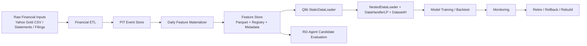
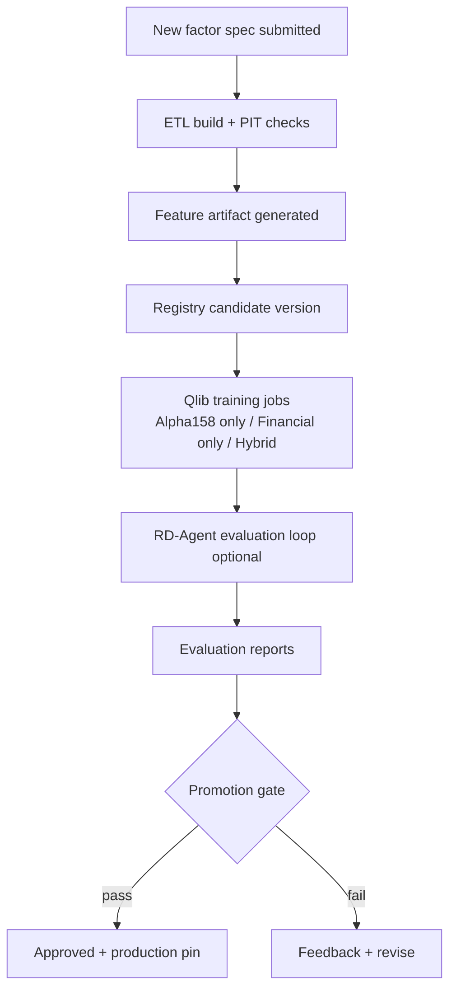

# Financial Feature Store Architecture (NA Quant Platform)

Date: 2026-07-01  
Scope: Platform architecture design only (no implementation)

## 1. Objective

Design a production-grade Financial Feature Store for the North America quantitative platform so that:

1. Quarterly/irregular financial disclosures are transformed into daily point-in-time-safe features.
2. Features are versioned, auditable, and rollbackable.
3. Qlib can consume standardized features directly through StaticDataLoader.
4. New factors can automatically enter training and RD-Agent evaluation workflows.

This document treats RD-Agent as a research component, while the Feature Store is the platform core.

---

## 2. Positioning

Target platform perspective:

```text
Yahoo / filings / analyst / macro / news
  -> ETL + PIT governance
  -> Financial Feature Store
  -> Qlib (DatasetH/DataHandler/StaticDataLoader)
  -> RD-Agent factor research + model evaluation
  -> backtest + production prediction
```

RD-Agent is important, but it is not the system of record for features.

---

## 3. Design Principles

1. PIT-first: `available_from` decides feature visibility, never `period_end`.
2. Schema contracts over ad-hoc scripts: every table has required fields and validation rules.
3. Immutable versions: no in-place overwrite of approved feature versions.
4. Reproducibility: training run can trace exact code + data + config + feature set.
5. Loader compatibility: output format aligns with Qlib StaticDataLoader contract.
6. Decoupled evolution: ETL, feature engineering, modeling, and RD-Agent can evolve independently.

---

## 4. Target Architecture



---

## 5. Data Model (Canonical Contracts)

## 5.1 Raw Statement Layer (Bronze)

Purpose: preserve source truth.

Required columns:

- symbol
- statement_type (income_statement, balance_sheet, cash_flow, etc.)
- period_end
- report_date
- filing_datetime (if available)
- metric_name
- metric_value
- currency
- source_file
- ingestion_ts

Notes:

- Keep source granularity and lineage.
- No forward fill here.

## 5.2 PIT Event Layer (Silver)

Purpose: normalize availability semantics.

Required columns:

- instrument
- metric_name
- metric_value
- period_end
- report_date
- filing_datetime
- available_from
- effective_from
- effective_to
- asof_policy_version

Rules:

- `available_from = max(report_date, filing_datetime_date, policy_delay_adjusted_time)`
- never expose metric before `available_from`

## 5.3 Daily Feature Layer (Gold)

Purpose: Qlib-consumable daily panel.

Required index/columns:

- index: datetime, instrument
- columns: feature columns only (or MultiIndex with group=feature)
- per feature metadata key:
  - feature_name
  - frequency
  - source_metrics
  - lag_rule
  - transform_rule

Output format recommendation:

- parquet (primary)
- optional pickle export only for compatibility

---

## 6. PIT Alignment Specification (Most Critical)

## 6.1 Availability Rule

For any feature value at trading day `t`:

$$
feature(t) = f(raw\_metrics\_with\_available\_from \le t)
$$

Never use `period_end` as release proxy.

## 6.2 Materialization Steps

1. Build event timeline per instrument + metric using `available_from`.
2. Snap event value onto trading calendar at/after availability.
3. Apply forward fill under explicit stale-window rule.
4. Mark stale or missing values with quality flags.

## 6.3 Required PIT Validation Tests

1. Leak test: random sample where `datetime < available_from` must be null/unavailable.
2. Replay test: reconstruct features for historical as-of date and compare snapshots.
3. Delay policy test: verify configured lags (e.g., filing + N hours/day) are applied.

---

## 7. Feature Versioning, Audit, Rollback

## 7.1 Version Entity

`FeatureSetVersion` example fields:

- feature_set_id
- version (semantic or date-build, e.g., 2026.07.01-r3)
- build_id
- git_commit
- etl_code_version
- schema_version
- asof_policy_version
- start_date / end_date
- universe
- checksum
- status (candidate, approved, production, deprecated, retired)

## 7.2 Registry Entities

1. FactorSpec
- name, category, frequency, owner, dependencies
2. FactorDataVersion
- data artifact URI, partition info, checksum
3. FactorEvalReport
- IC, RankIC, ICIR, portfolio impact, redundancy, stability
4. PromotionRecord
- promoted_by, approved_at, reason

## 7.3 Rollback Strategy

- Production pin points to immutable `feature_set_version`.
- Rollback = pointer switch to previous approved version.
- No destructive overwrite.

---

## 8. Qlib Integration Standard

## 8.1 Loader Stack

Recommended chain:

```text
StaticDataLoader (financial features parquet)
  + optional Alpha158DL or other loaders
  -> NestedDataLoader
  -> DataHandlerLP
  -> DatasetH/TSDatasetH
```

## 8.2 Standard Index/Schema for StaticDataLoader

Required:

- MultiIndex: `datetime`, `instrument`
- time granularity aligned to Qlib calendar
- deterministic column naming convention

Recommended naming:

- `fin__profitability__gross_margin_ttm`
- `fin__growth__revenue_yoy`
- `fin__quality__accrual_ratio`

## 8.3 Label Governance

Labels are configuration assets, not hard-coded assumptions.

Examples:

- 1-day: `Ref($close,-2)/Ref($close,-1)-1`
- 5-day horizon label
- 20-day horizon label
- 60-day horizon label

All label definitions must be versioned with the same experiment config.

---

## 9. Automation: From New Factor to Evaluation



Promotion gate minimum checks:

1. PIT leak checks passed
2. data quality thresholds passed
3. IC/RankIC/ICIR thresholds passed
4. redundancy under threshold
5. turnover/cost constraints acceptable

---

## 10. Monitoring and Retirement

## 10.1 Online Monitoring Metrics

- rolling IC mean/vol
- rank IC stability
- feature missing ratio
- freshness lag
- drift score vs training distribution
- portfolio contribution deterioration

## 10.2 Retirement Policy Example

Auto-mark `deprecated` if both conditions hold for N windows:

1. rolling IC mean below threshold
2. redundancy/correlation too high vs newer features

Then:

- remove from production feature set
- retain artifact and metadata for audit

---

## 11. Recommended Store Layout

```text
.qlib/feature_store/
  financial/
    feature_set=<name>/
      version=<version>/
        data/
          features.parquet
        metadata/
          feature_set.yaml
          schema.json
          checksums.json
          eval_report.json
```

Registry can be file-based (initial) or DB-backed (later), but version immutability must hold.

---

## 12. Operating Model

1. Research lane (fast): RD-Agent proposes and validates candidates.
2. Platform lane (safe): Feature Store controls PIT, versioning, and promotion.
3. Production lane (stable): Qlib consumes approved immutable feature versions.

This separation lets you scale to:

- Financial + Macro + Technical + News + Analyst features
- LightGBM/XGBoost/CatBoost and future models
- CA/US and unified NA universes

---

## 13. Immediate Next Steps (No Coding Yet)

1. Define PIT policy document (availability rules by source type).
2. Define canonical schema files for Bronze/Silver/Gold layers.
3. Define FeatureSetVersion metadata schema and promotion checklist.
4. Draft three benchmark experiment configs:
- Alpha158 only
- Financial only
- Alpha158 + Financial
5. Define monitoring and retirement thresholds for first production cycle.

---

## 14. Final Architecture Decision

For this project stage, the decisive architectural move is:

Build Financial Feature Store first, then let Qlib and RD-Agent consume it.

In other words:

```text
Financial Platform
  -> Qlib pipeline
  -> RD-Agent research loop
```

not the reverse.
