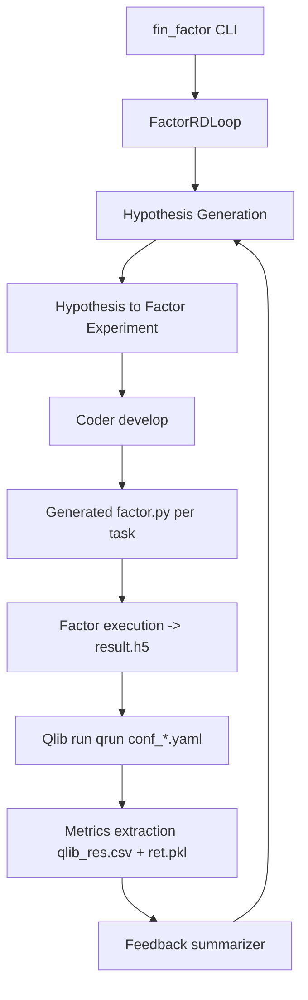
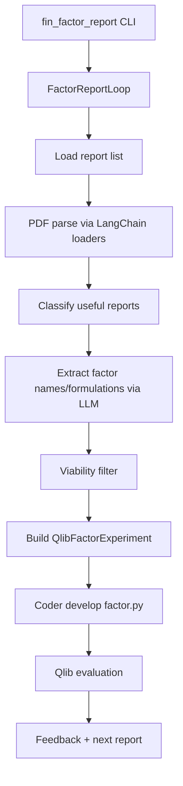

# RD-Agent + Qlib Financial Factor Integration Research

Date: 2026-07-01  
Scope: Research only (no implementation)

Follow-up source-level architecture analysis is available in:
`rdagent/docs/research/15_RD-Agent_Source_Code_Architecture.md`

## Research Environment Baseline

To avoid environment ambiguity, this research is grounded on the repository-local RD-Agent environment:

- Repository root: `/Users/weiliu/projects/Qlib_Canada_Market_Support_Project_Plan/rdagent`
- RD-Agent package source folder: `/Users/weiliu/projects/Qlib_Canada_Market_Support_Project_Plan/rdagent/rdagent`
- Virtual environment: `/Users/weiliu/projects/Qlib_Canada_Market_Support_Project_Plan/rdagent/.venv/bin/activate`

Verified runtime facts in this environment:

- `python` points to `/Users/weiliu/projects/Qlib_Canada_Market_Support_Project_Plan/rdagent/.venv/bin/python`
- Python version is `3.11.15`
- `rdagent` points to `/Users/weiliu/projects/Qlib_Canada_Market_Support_Project_Plan/rdagent/.venv/bin/rdagent`
- `rdagent fin_factor --help` and `rdagent fin_factor_report --help` both execute successfully

## 1. Executive Summary

This document evaluates how Microsoft RD-Agent can be integrated into the current North America Qlib platform to automatically discover, implement, and evaluate financial factors.

Key conclusions:

1. `rdagent fin_factor` is a full iterative R&D loop: hypothesis generation -> factor task generation -> code generation (`factor.py`) -> execution/backtest in Qlib -> feedback -> next loop.
2. `rdagent fin_factor_report` is currently PDF-first. It parses reports, extracts factors via LLM, then enters the same coding/evaluation loop.
3. RD-Agent does **not** directly consume your `income_statement/`, `balance_sheet/`, `cash_flow/`, `earnings_dates/` CSV folders as first-class inputs in current command flow.
4. RD-Agent factor outputs are represented as `FactorTask` objects and generated Python implementations that produce daily MultiIndex feature tables; these are merged into Qlib through `StaticDataLoader` + `DataHandlerLP` during evaluation.
5. Recommended production architecture is a controlled hybrid of Option C + Option A:
   - Option C for robust financial ETL and point-in-time governance.
   - Option A for model training with `Alpha158 + approved financial features` through existing `DatasetH`/`DataHandler` pipeline.
6. Look-ahead bias prevention is **not automatic** in RD-Agent financial report workflows. It must be enforced in ETL and feature materialization with `report_date`/filing availability timestamps (not period end).

---

## 2. Current NA Platform Context

Current project pipeline:

```text
Yahoo
  -> stock_data/
  -> Qlib (NA data already supported)
  -> LightGBM
  -> Prediction
```

Current NA task config already uses:
- `provider_uri: ~/.qlib/qlib_data/na_data`
- `DatasetH`
- `qlib.contrib.data.handler.Alpha158`
- `LGBModel`

This is a strong base for integrating generated financial features without replacing your current modeling stack.

---

## 3. How `rdagent fin_factor` Works Internally

## 3.1 CLI Entry

`rdagent` command is registered via Typer and routes:
- `fin_factor` -> `rdagent.app.qlib_rd_loop.factor.main`

## 3.2 Core Loop Architecture

`fin_factor` runs `FactorRDLoop`, derived from generic `RDLoop`.

High-level chain:



## 3.3 Components and Responsibilities

- Scenario: `QlibFactorScenario`
- Hypothesis generator: `QlibFactorHypothesisGen`
- Hypothesis-to-experiment: `QlibFactorHypothesis2Experiment`
- Coder: `QlibFactorCoSTEER` (alias of `FactorCoSTEER`)
- Runner: `QlibFactorRunner`
- Summarizer: `QlibFactorExperiment2Feedback`

Configured through `FactorBasePropSetting` (`QLIB_FACTOR_*` settings).

## 3.4 Generated Code and Data Artifacts

For each factor task, RD-Agent generates Python implementation (`factor.py`) with a required interface:

- has `calculate_{function_name}`
- writes `result.h5`
- output is pandas DataFrame indexed by `datetime`, `instrument`, single feature column

Evaluation pipeline artifacts include:

- factor runtime output: `result.h5`
- merged candidate + baseline feature table: `combined_factors_df.parquet`
- Qlib metrics export: `qlib_res.csv`
- portfolio return series pickle: `ret.pkl`

## 3.5 Evaluation Logic

Evaluation includes both code-level validity and Qlib performance:

- Code/data checks in factor coding evaluator chain (output format, datetime frequency, NaN/INF checks, index compatibility, etc.)
- Full Qlib run (`qrun`) using templates:
  - `conf_baseline.yaml`
  - `conf_combined_factors.yaml`
  - `conf_combined_factors_sota_model.yaml`
- Result extraction from latest recorder into `qlib_res.csv`
- Feedback generator compares key metrics vs SOTA experiment

Important metrics explicitly used in summarizer:
- `IC`
- `1day.excess_return_with_cost.annualized_return`
- `1day.excess_return_with_cost.max_drawdown`

Additional metrics can still exist in `qlib_res.csv` depending on Qlib records (`SigAnaRecord`, `PortAnaRecord`).

---

## 4. How `rdagent fin_factor_report` Works

## 4.1 CLI Entry

- `fin_factor_report` -> `rdagent.app.qlib_rd_loop.factor_from_report.main`

## 4.2 Workflow



## 4.3 Expected Report Input Format

Supported by this command flow:

1. Folder path containing PDF files (recursive `*.pdf` discovery).
2. JSON list file (`report_result_json_file_path`) containing PDF file paths.

Example JSON list:

```json
[
  "git_ignore_folder/report/fin_report1.pdf",
  "git_ignore_folder/report/fin_report2.pdf"
]
```

## 4.4 Report Parser / Loader Behavior

- Uses `PyPDFLoader` / `PyPDFDirectoryLoader` to parse PDFs
- Aggregates page content per document
- LLM-based document classification (useful vs not useful)
- LLM extraction for:
  - factor name
  - description
  - formulation
  - variables
- Viability filter is applied before experiment construction

Note: duplicate checking exists in module code but current final load path prioritizes viability-filtered factors.

## 4.5 Generated Outputs

Outputs align with standard factor loop:

- `QlibFactorExperiment` with `FactorTask` list
- generated factor implementation code
- backtest metrics (`qlib_res.csv`)
- return curves (`ret.pkl`)
- logs/traces for iterative review

---

## 5. Can RD-Agent Directly Consume Financial Statement CSVs?

Short answer: **not directly in current command defaults**.

## 5.1 Current Reality

- `fin_factor_report` expects PDF-centric report content extraction.
- `fin_factor` expects factor implementation source data folder already prepared for runtime execution and Qlib backtest integration.
- There is no built-in adapter in the command flow that ingests your raw statement directories (`income_statement/`, `balance_sheet/`, `cash_flow/`, `earnings_dates/`) as native first-class scenario input objects.

## 5.2 Implication

You need an ETL bridge that transforms statement CSVs into point-in-time daily feature tables (or PIT-compatible features) before RD-Agent/Qlib model evaluation stage.

---

## 6. How RD-Agent Represents Generated Factors

RD-Agent represents factors in multiple forms:

1. Semantic task object (`FactorTask`)
   - `factor_name`
   - `factor_description`
   - `factor_formulation`
   - `variables`

2. Generated implementation code (`factor.py`)
   - must execute and write `result.h5`

3. Evaluated feature table form
   - per-factor DataFrame (`datetime`, `instrument`) -> merged into `combined_factors_df.parquet`

4. Experiment-level object (`QlibFactorExperiment`)
   - includes tasks, workspaces, base features, history links

5. Feedback object (`HypothesisFeedback`)
   - observations, hypothesis evaluation, replacement decision

This is more than prompt-only generation; it is an executable, evaluated loop with code and artifacts.

---

## 7. Integration Architecture Options (A/B/C) and Recommendation

## 7.1 Option A

```text
RD-Agent -> financial factors -> processed features -> Alpha158 + Financial -> LightGBM
```

Pros:
- Fits existing `DatasetH` + `Alpha158` flow
- Lower operational risk
- Easier rollback

Cons:
- Requires separate ETL governance layer for statement timing and feature quality

## 7.2 Option B

```text
RD-Agent -> generate Qlib feature code -> Qlib feature library -> Alpha158 -> LightGBM
```

Pros:
- Elegant if stable and highly standardized

Cons:
- Higher maintenance burden
- Directly modifying feature/operator library risks technical debt and compatibility issues
- Harder to isolate experimental factors from production core

## 7.3 Option C

```text
RD-Agent -> generate Python ETL -> daily feature table -> Qlib
```

Pros:
- Strong governance, testability, and reproducibility
- Clear ownership boundaries (data engineering vs model loop)
- Best for point-in-time controls and NA multi-market scaling

Cons:
- More pipeline engineering upfront

## 7.4 Recommended Design

Recommend **Option C (core) + Option A (serving/training integration)**.

Why:

1. Preserves your current North America Qlib workflow and model training conventions.
2. Keeps financial statement alignment, release lag, and data quality controls in a deterministic ETL layer.
3. Lets RD-Agent focus on factor ideation + coding + evaluation without becoming a raw data ingestion system.

---

## 8. Cleanest Qlib Integration Point for Custom Factors

For this platform, clean integration point is:

1. Materialize approved financial factors as daily panel table (`datetime`, `instrument`, feature columns).
2. Load via `StaticDataLoader` in a `NestedDataLoader` alongside Alpha158 features.
3. Use `DataHandlerLP` + `DatasetH` unchanged at pipeline boundary.

This follows the same pattern RD-Agent itself uses in factor templates (`Alpha158DL` + `StaticDataLoader` joined in handler config).

Recommended boundary principle:

- Qlib core and existing NA config stay stable.
- New financial factors arrive as external, versioned feature datasets.

---

## 9. Daily Features vs Qlib Expressions

## 9.1 Daily Materialized Features

Advantages:
- Best for financial statements with irregular report cadence and delayed availability
- Easy to enforce publish-date lag rules
- Faster runtime (precomputed)
- Strong lineage and auditability

Limitations:
- Storage overhead
- Requires ETL scheduling/versioning

## 9.2 Qlib Expressions

Advantages:
- Compact specification
- Flexible experimentation for price/volume transformations

Limitations for statement factors:
- Harder to encode complex point-in-time release logic
- Greater risk of accidental look-ahead
- More operator/feature engine complexity for cross-statement joins

Recommendation:

- Statement-derived factors -> daily materialized features (default)
- Lightweight technical transforms -> expression layer (optional)

---

## 10. Look-Ahead Bias Control

## 10.1 Critical Rule

Financial factors must become available on/after `report_date` (or filing availability timestamp), never at `period_end`.

## 10.2 Does RD-Agent Already Enforce This?

- Not fully in `fin_factor` / `fin_factor_report` workflow.
- These workflows evaluate generated factors but do not inherently guarantee statement release-time governance.

## 10.3 How to Enforce in Future Design

1. Build a point-in-time ETL layer:
   - input keys include `period_end`, `report_date`, `filing_datetime`
   - output daily factor values are forward-filled only after release timestamp
2. Add data tests:
   - no factor value present before release
   - random sample replay checks per symbol/date
3. Keep explicit metadata columns:
   - `source_period_end`
   - `source_report_date`
   - `available_from`
4. Integrate into validation gate before model training

Note: Qlib has PIT support concepts/operators (e.g., `P`/`PRef`) that can help, but governance must still be designed at data pipeline level for production consistency.

---

## 11. Factor Evaluation and Filtering Before Production

Current RD-Agent/Qlib loop provides:

1. Implementation validity checks (shape/index/execution)
2. Redundancy control:
   - similarity filter against SOTA factors (correlation-based threshold in runner)
   - report extraction viability filtering
3. Performance checks in Qlib backtest metrics
4. Iterative feedback-driven selection

Suggested production filter stack:

1. Data quality gate (null, staleness, symbol/date coverage)
2. Point-in-time leakage gate
3. Predictive signal gate:
   - IC / RankIC / ICIR rolling windows
4. Portfolio impact gate:
   - annualized excess return
   - max drawdown
   - turnover / cost-aware metrics
5. Redundancy gate:
   - pairwise correlation / VIF / clustering
6. Stability gate:
   - market regime robustness (CA-only, US-only, mixed NA)

---

## 12. Proposed End-to-End Future Workflow


## 12.1 Operating Model

- Research lane:
  - RD-Agent explores candidate factors rapidly.
- Production lane:
  - only approved, versioned, PIT-compliant factors promoted.
- Shared registry:
  - factor definitions, code snapshots, ETL lineage, and evaluation reports.

---

## 13. Risks and Mitigations

1. Look-ahead leakage risk
   - Mitigation: strict `available_from` logic and leakage tests.
2. LLM extraction hallucination from reports
   - Mitigation: formula validation + unit tests + human review checkpoints.
3. Overfitting to historical regimes
   - Mitigation: rolling OOS windows and regime-segmented validation.
4. Operational drift in feature pipelines
   - Mitigation: schema contracts, data freshness SLAs, and versioned feature tables.
5. Tight coupling to generated code quality
   - Mitigation: code lint/test gate and sandbox runtime checks before merge.

---

## 14. Future Implementation Roadmap (No Code in This Phase)

Phase 0: Research Baseline (done by this document)
- Confirm internals, formats, and integration boundaries.

Phase 1: Financial PIT ETL Foundation
- Define canonical statement schema and `available_from` policy.
- Build daily materialized financial feature tables for NA universe.

Phase 2: RD-Agent Candidate Factor Loop
- Feed ETL-prepared datasets into RD-Agent coding/evaluation process.
- Record artifacts and metrics in experiment registry.

Phase 3: Qlib Integration Hardening
- Integrate approved factors through `StaticDataLoader` + existing handlers.
- Add automated validation gates (leakage/performance/redundancy).

Phase 4: Multi-Model Productionization
- Expand beyond LightGBM to XGBoost/CatBoost with same feature contracts.
- Add daily batch prediction and monitoring.

Phase 5: Governance and Monitoring
- Continuous drift detection (data + factor + model).
- Quarterly factor retirement and retraining policy.

---

## 15. Final Recommendation

For long-term maintainability of the North America quantitative trading platform:

1. Keep Qlib core workflow stable (`DatasetH` + handler + model configs).
2. Put financial statement semantics into a dedicated point-in-time ETL layer.
3. Use RD-Agent as an automated factor R&D engine, not as the raw statement ingestion layer.
4. Promote only validated and approved factors into production feature registry.
5. Treat look-ahead control as a mandatory release gate.

This approach gives the best balance of speed, reproducibility, scalability, and risk control for NA market expansion.
